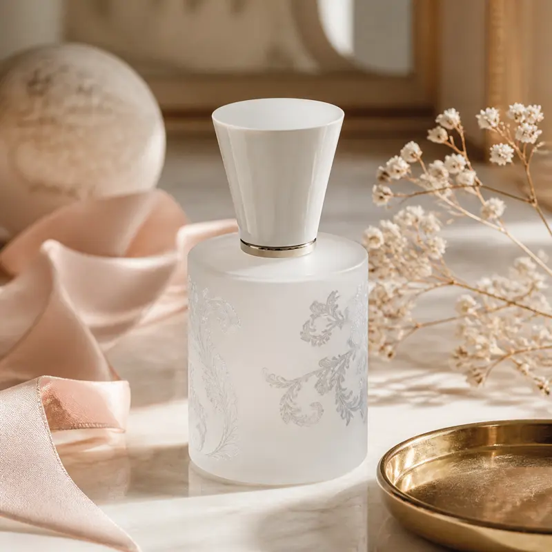
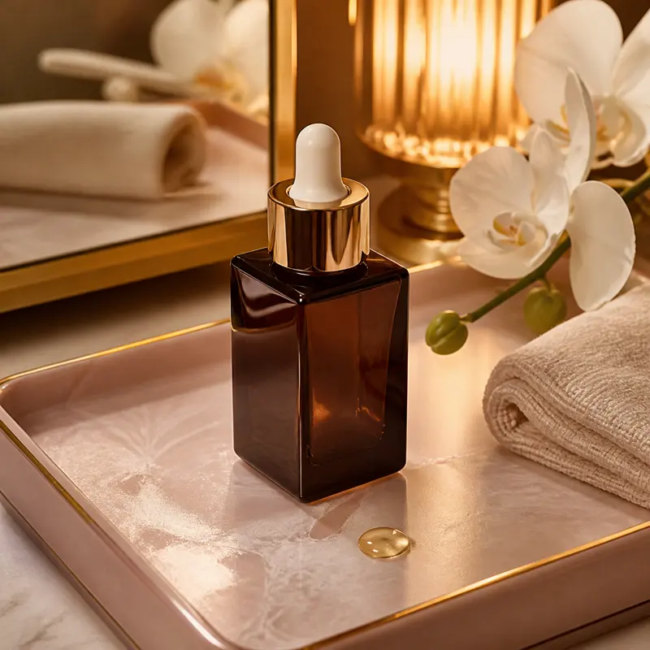
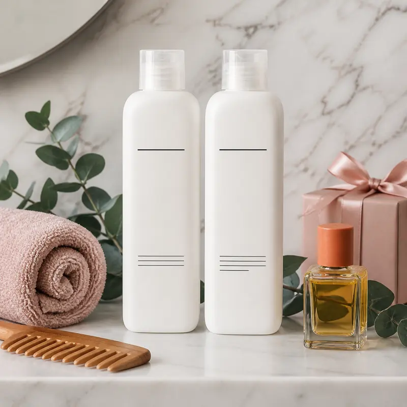

Shopping for Christmas beauty gifts for your wife can feel like a minefield. Makeup shades are easy to get wrong, and a random gift set from the drugstore rarely feels special. The gifts that land are the luxurious versions of things she already uses: a signature scent, a serum she can look forward to at night, and a hair routine that feels like a salon visit.

That is how we chose the three gifts below. Each one is a well-known name in beauty, each is sold by Amazon.com, and each has thousands of Amazon ratings. We checked every rating and rating count on Amazon on the date above. Prices change often during the holidays, so check the current price on Amazon before you order.

## Best signature scent: Juliette Has a Gun Not a Perfume Eau de Parfum

### Why we like it

Not a Perfume is one of the most talked-about fragrances of the past decade because it breaks the usual rules. Instead of a blend of dozens of notes, it is built around a single ingredient, Cetalox, which gives it a soft, clean, woody, musky and ambery character. It tends to smell like warm skin rather than a loud perfume, which is exactly why it works as a gift: it is hard to dislike.

The fragrance was created by Romano Ricci, the founder of Juliette Has a Gun, and the brand markets it as an allergen-free fragrance. The 1.7 fl oz bottle linked here is a generous everyday size in the brand's frosted white bottle, which looks lovely on a dresser. It is an eau de parfum, the brand describes it as long-lasting, and it has a strong rating across more than 8,000 ratings.

### Who it's for

Wives who like minimalist, clean scents, anyone who finds most perfumes too strong, and women who want a "my skin but better" signature fragrance.

### Pros

- Soft, woody-musky single-note scent that is easy to wear every day
- Marketed by the brand as allergen-free
- Pretty bottle that feels like a real luxury gift
- Strong 4.5-star rating across more than 8,000 ratings
- Also sold in a 0.25 oz purse spray and a 3.3 fl oz bottle

### Cons

- Very subtle on some people, who may want to reapply
- Fans of big floral or gourmand perfumes may find it too quiet
- A gift receipt is smart, since fragrance is always personal

{{ product B0130MFX74 }}

## Best skincare splurge: Estée Lauder Advanced Night Repair Serum

### Why we like it

Advanced Night Repair is one of the most recognizable bottles in beauty, and it is a gift many women would love but rarely buy for themselves. Estée Lauder formulates it with its Synchronized Multi-Recovery Complex, peptides and hyaluronic acid, and positions it as a nighttime serum that helps skin hold on to moisture while she sleeps.

The 1.7 fl oz bottle in this guide comes in the classic dark brown glass with a gold collar and dropper, so it looks like a luxury gift the moment she opens it. Estée Lauder also says the formula is free of synthetic fragrance, parabens, phthalates, sulfates, sulfites and mineral oil, which matters to many skincare shoppers. It has a 4.6-star rating across nearly 4,000 ratings.

### Who it's for

Wives who already have a skincare routine, anyone who loves classic luxury brands, and women who enjoy a calm nighttime ritual.

### Pros

- An iconic luxury serum that feels like a true splurge
- Made with peptides and hyaluronic acid
- Free of synthetic fragrance, parabens, phthalates and mineral oil, according to Estée Lauder
- Easy to slot into any routine before moisturizer
- 4.6-star rating across nearly 4,000 ratings

### Cons

- The priciest gift on this list
- Skincare results vary from person to person
- Anyone with very sensitive skin should patch test first

{{ product B08DHQCGH9 }}

## Best for gorgeous hair: OLAPLEX Wash and Shine Hair Kit

### Why we like it

OLAPLEX is a favorite with stylists and with anyone who colors, bleaches or heat-styles their hair. This kit brings three of its best-known products together in one gift: No.4 Bond Maintenance Shampoo, No.5 Bond Maintenance Conditioner and No.7 Bonding Oil. That covers her wash day from start to finish, which makes it feel more complete than a single bottle.

The No.7 oil is the star for many fans. OLAPLEX says it adds shine and softness, helps control frizz for up to 72 hours and offers heat protection before styling. The kit has a 4.6-star rating across more than 6,000 ratings, and because it is a set, it arrives as a ready-made gift.

### Who it's for

Wives who color their hair, use hot tools often, or love the feel of salon hair care at home.

### Pros

- Shampoo, conditioner and styling oil in one gift
- Trusted salon brand with a loyal following
- Frizz control and heat protection claims for the No.7 oil, according to OLAPLEX
- 4.6-star rating across more than 6,000 ratings
- Useful every wash day

### Cons

- Some fans prefer to buy only the No.7 oil
- Very fine hair may find the oil too rich if overused
- Not as personal as a fragrance gift

{{ product B0D4SBLLRJ }}

## How to choose a beauty gift for your wife

Look at what is already on her vanity. If she wears perfume most days, a new signature scent is a thoughtful upgrade. If she has a nightly skincare routine, a luxury serum feels like a treat she would not buy herself. If she spends time on her hair, a premium hair kit is something she will use every week.

When in doubt, choose the gift with the lowest risk of a mismatch. Hair care and a soft, skin-like fragrance are easier to get right than makeup or strongly scented products.

## Gift bundle ideas

- **The night-in:** Advanced Night Repair with a silk pillowcase and a cozy robe.
- **The signature scent:** Not a Perfume with a handwritten note about why it made you think of her.
- **The salon at home:** the OLAPLEX kit with a soft microfiber hair towel and a wide-tooth comb.

## Buying tips

- **Buy from Amazon.com or the brand:** all three picks were sold by Amazon.com when we checked, which helps avoid counterfeit beauty products.
- **Check the size:** beauty listings often group several sizes on one page, so confirm the one in your cart.
- **Include a gift receipt:** it makes exchanges easy if she already owns it.
- **Check the current price on Amazon:** holiday prices change daily, so compare before you buy.

Looking for more ideas? See our [luxury skincare gift guide](/beauty/luxury-skincare-gift-guide/), our [glam gifts for her](/beauty/glam-gifts-for-her-skincare-scent-palette/), our [beauty stocking stuffers](/beauty/beauty-stocking-stuffers/) and our [winter hair care picks](/beauty/winter-hair-care-for-dry-hair/), or browse the full [holiday gift guide](/holiday-gift-guide/).

## The bottom line

If you want one Christmas beauty gift that feels personal and luxurious, choose **Juliette Has a Gun Not a Perfume**. It is soft, easy to wear and comes in a bottle she will love to keep on her dresser. For a wife who loves skincare, **Estée Lauder Advanced Night Repair** is the classic splurge she will look forward to every night. And for the one who cares about her hair, the **OLAPLEX Wash and Shine Hair Kit** turns wash day into a salon-style ritual.
