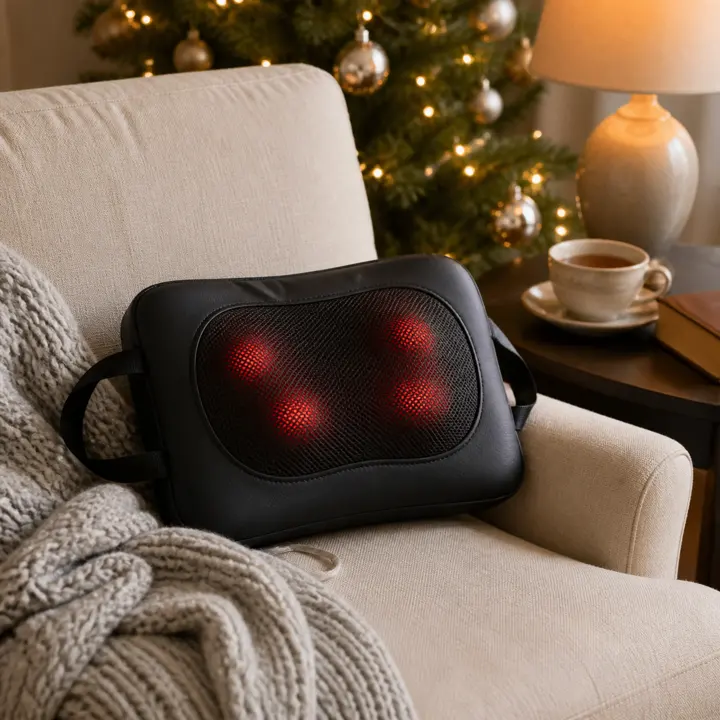
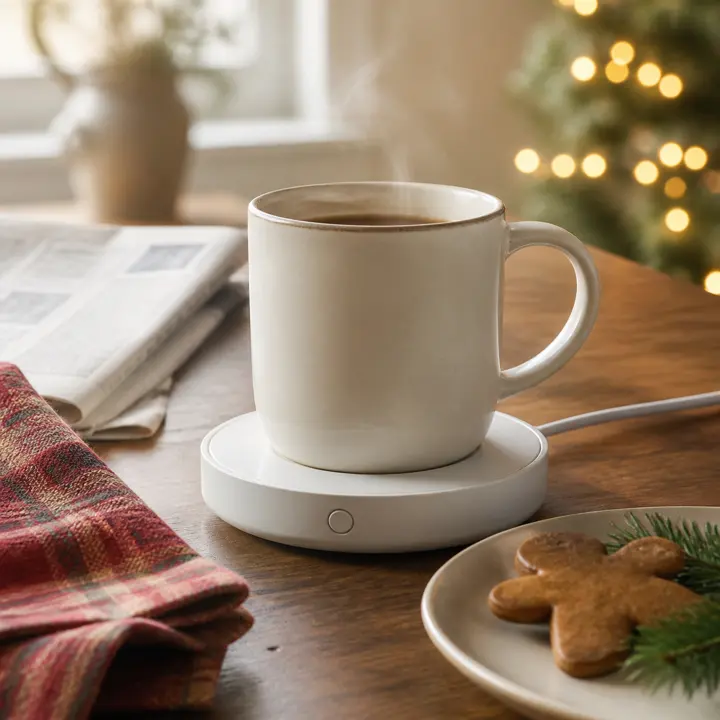

Buying Christmas gifts for parents gets harder every year. They already own what they need, they tell you not to spend money, and anything decorative ends up in a closet. The gifts that land are the ones they use every day: something that keeps the family close, something that eases a sore back after a long day, and something that makes the morning coffee a little better.

That is how we chose the three cozy gifts below. Each one is a top seller with thousands of reviews, each one works for Mom or Dad, and each one is easy for someone who is not into gadgets. We checked every rating and rating count on Amazon on the date above. Prices change often during the holidays, so check the current price on Amazon before you order.

## Best overall: Aura Carver 10.1-Inch WiFi Digital Picture Frame

### Why we like it

If your parents live far from you or from the grandkids, this is the gift they will talk about. You send photos and short videos from your phone through the free Aura app, by email or by text, and they show up on the frame in their living room. Siblings, cousins and grandkids can be invited to add photos too, so the frame keeps filling up long after Christmas morning.

Aura built it for gifting. You can preload photos, videos and a gift message in the app before you wrap it, and it ships in gift-ready packaging. Setup takes about a minute on WiFi, which matters for parents who dread new devices. The listing also highlights free unlimited storage with no subscription fee, portrait pairing (two vertical photos shown side by side), adjustable slideshow speed, automatic on/off at night, and support for live photos and videos up to 30 seconds with sound.

### Who it's for

Grandparents, long-distance parents, and anyone who still prints photos to stick on the fridge. It is also a great group gift from siblings, since everyone can contribute photos.

### Pros

- Family members add photos from anywhere, so the gift keeps updating itself
- Preload photos and a message before you give it
- No subscription fee and free unlimited storage, according to Aura
- About one minute to set up on WiFi
- Very strong rating across more than 14,000 reviews

### Cons

- Needs a home WiFi connection to receive new photos
- The priciest gift on this list
- The 10.1-inch landscape screen is best on a side table or shelf, not across a big room

{{ product B0GR6YMKHX }}

## Best for sore backs: Zyllion ZMA-13 Shiatsu Back and Neck Massager with Heat

### Why we like it

Ask most parents where it hurts and they will point to their lower back or the back of the neck. This compact cushion uses 3D kneading silicone nodes, with optional heat, to work on the upper and lower back. It is contoured, so it also works on the neck, shoulders, calves and feet, and adjustable straps keep it in place on an office chair or a car seat. A car adapter is included.

The safety details are why we feel good giving it to older parents. It is certified by TÜV SÜD to the UL 1647 electrical safety standard, it has overheat protection, and it shuts off by itself after 20 minutes, so nobody falls asleep with it running. The nodes change direction every minute. Zyllion also offers a 3-year warranty (one year automatically plus a two-year extension when you register).

### Who it's for

Parents who garden, stand all day, sit at a desk or drive a lot. It is an easy gift for Dad that still feels thoughtful, and it shares well between two people.

### Pros

- Heat plus deep-kneading shiatsu nodes in one compact cushion
- Works on the back, neck, shoulders, legs and feet
- 20-minute auto shut-off and overheat protection
- Car adapter and straps for chairs and car seats
- Over 51,000 ratings and a 3-year warranty with registration

### Cons

- Corded design, so it needs an outlet or the car adapter
- Deep kneading can feel intense; the included pull-over sleeve softens it
- Not a substitute for medical care for serious back problems

{{ product B00BOYA2M2 }}

## Best stocking stuffer: VOBAGA Coffee Mug Warmer with Auto Shut-Off

### Why we like it

Every family has a parent who pours a coffee, gets distracted by the newspaper or a phone call, and comes back to a cold mug. This small warmer plate fixes that. It has three temperature settings, 104°F, 131°F and 149°F, which you cycle through with a single touch button.

For forgetful moments, it turns itself off after four hours. When it does, an indicator light keeps flashing to warn that the plate is still hot, and stops once it cools to about 97°F. The plate is spill-proof and wipes clean, and the 60-inch UL power cord reaches most outlets on a kitchen table or desk.

### Who it's for

Slow sippers, tea drinkers, parents who work from home, and anyone who reheats the same cup in the microwave three times a morning. It is also the easiest add-on if you are bundling a few smaller gifts.

### Pros

- Three temperature settings with one-touch control
- Four-hour auto shut-off plus a hot-surface reminder light
- Compact and spill-proof, wipes clean
- Thousands of reviews and the easiest gift on the list to wrap

### Cons

- Works best with thin-walled, flat-bottom mugs; not for double-wall insulated cups
- Keeps drinks warm rather than heating cold drinks quickly
- It is corded, so it stays near an outlet

{{ product B07G139Z7L }}

## How to choose a Christmas gift for your parents

- **Start with their daily routine.** Morning coffee, an evening on the couch, a weekly call with the grandkids. A gift that fits a habit gets used.
- **Keep the tech simple.** Choose devices with one button or a one-minute setup, and set them up yourself before you wrap them when you can.
- **Think about safety.** Auto shut-off timers matter more for older parents. All three picks here turn off on their own.
- **Gift together.** Siblings can split a bigger gift like the Aura frame, then each add their own photos.
- **Make it personal.** Preload the frame with photos from the year, or tuck a handwritten note under the mug warmer.

## Gift bundle ideas

- **The family connection:** Aura frame preloaded with the year's best photos and a short video message from the grandkids.
- **The cozy evening:** the Zyllion massager with a soft throw blanket for the couch.
- **The slow morning:** the VOBAGA warmer with a favorite mug and a bag of their go-to coffee or tea.
- **The full set for both parents:** the frame for the living room, the massager for Dad and the mug warmer for Mom (or the other way around).

## Buying tips

- **Order early:** popular colors sell out near Christmas, and you want time to load the frame before you wrap it.
- **Check the mug:** if your parents use insulated tumblers, add a simple ceramic mug so the warmer works properly.
- **Include a gift receipt:** it makes exchanges easy if they already own something similar.
- **Check the current price on Amazon:** holiday prices change daily, so compare before you buy.

Looking for more ideas? See our [tech gifts for dad](/tech/tech-gifts-for-dad/), our [cozy gifts for her](/gifts/cozy-gifts-for-her/), our [gifts for coffee lovers](/gifts/gifts-for-coffee-lovers/) and our [muscle recovery tools for home](/fitness/muscle-recovery-tools-at-home/).

## The bottom line

If you buy one Christmas gift for your parents this year, make it the **Aura Carver digital picture frame**. It is easy to set up, the whole family can keep it filled with new photos, and it keeps you in their living room every day. For a parent with a sore back, the **Zyllion ZMA-13 heated shiatsu massager** is a cozy, practical gift with an impressive number of ratings. And for the parent who always leaves their coffee to go cold, the **VOBAGA mug warmer** is a small, inexpensive stocking stuffer they will use every morning.
