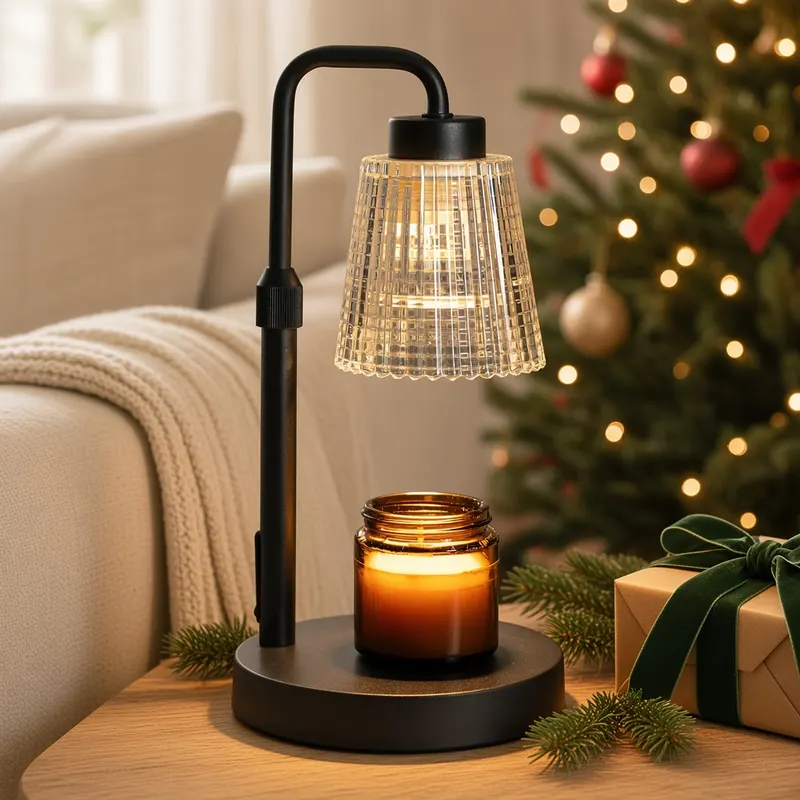
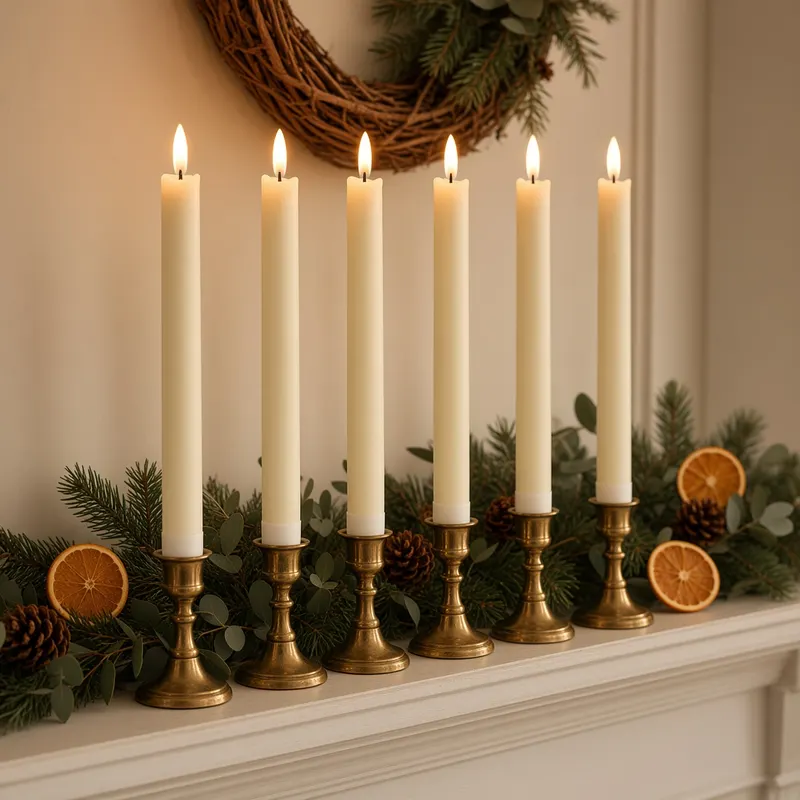
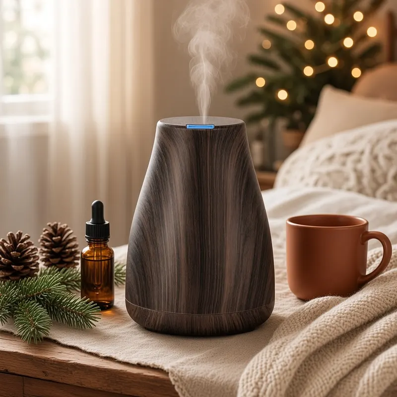

The best Christmas gifts for the home are not the biggest ones. They are the small things that change how a room feels at 6 PM on a dark December evening: a soft glow on the side table, candlelight on the mantel, a gentle scent drifting through the living room. They also have a big advantage for the person shopping: you do not need to know someone's exact decor style to get them right.

We picked three cozy, giftable home upgrades that fit almost any house, apartment or first home. Each one is a best seller with thousands of Amazon ratings, and each one is flame-free or close to it, which matters in homes with kids, pets or a real Christmas tree. We checked every rating and rating count on Amazon on the date above. Prices change often during the holidays, so check the current price on Amazon before you order.

## Best overall: GODONLIF Candle Warmer Lamp with Timer

### Why we like it

A candle warmer lamp is the kind of gift people would not buy for themselves and then use every single night. Instead of lighting the wick, you set a jar candle on the base and the halogen bulb in the shade melts the wax from the top down. The candle releases its scent with no open flame, no smoke and no soot, and the lamp doubles as a warm accent light.

The GODONLIF version looks like a small vintage task lamp: a black metal base and curved arm with a clear ribbed glass shade. The pole is height-adjustable, so it works with short and tall jar candles, and a dimmer knob controls both the brightness and how fast the wax melts. It also has a built-in timer, which means nobody has to remember to switch it off at bedtime. The listing says it comes with 2 bulbs, so there is a spare in the box. It holds a 4.6-star rating across nearly 12,000 ratings.

### Who it's for

Anyone who already owns a shelf of jar candles, new homeowners, renters in buildings that frown on open flames, and families with curious pets or small kids. Pair it with their favorite holiday candle for a complete gift.

### Pros

- No open flame, smoke or soot
- Dimmer and timer for easy, set-and-forget use
- Height-adjustable pole fits different jar sizes
- Looks like a real decor piece, not an appliance
- 4.6-star rating across nearly 12,000 ratings

### Cons

- Only works with jar candles, not pillars or tapers
- The halogen bulb and metal shade get hot, so keep it out of reach of small hands
- Needs an outlet near the spot where you want it

{{ product B0CTJGJL2T }}

## Best for holiday decor: GenSwin Flameless Taper Candles with Remote

### Why we like it

Taper candles are the fastest way to make a mantel or dinner table look like Christmas, but real ones drip, burn down and cannot be left alone. This GenSwin set fixes all of that. You get six ivory tapers, each about 9.6 inches tall and 0.78 inches wide, made with a real wax exterior and a 3D wick that flickers like a flame.

The included 10-key remote is the part people love. One button turns all six on or off, and you can set a 2, 4, 6 or 8 hour timer so the candles come on every evening by themselves. You can also adjust the brightness and switch between a flickering candle mode and a steady light. They can stand in regular candlesticks or on their own. The set has a 4.5-star rating across more than 15,900 ratings.

### Who it's for

People who decorate for the holidays, anyone with a mantel, a long dining table or deep window sills, and hosts who want candlelight at dinner without watching a flame. They are also a safe pick for homes with pets.

### Pros

- Real wax exterior and 3D flickering wick look convincing from a distance
- One remote controls all six candles
- 2/4/6/8 hour timer, brightness control and two light modes
- No dripping wax, smoke or fire risk
- 4.5-star rating across more than 15,900 ratings

### Cons

- Each candle needs 2 AAA batteries, which are not included
- Candle holders are not included
- Up close, the flame is clearly an LED

{{ product B07YHPRWSF }}

## Best for a cozy scent: InnoGear Essential Oil Diffuser

### Why we like it

A diffuser is a home gift that works long after the tree comes down. Add water and a few drops of essential oil, and the ultrasonic plate turns it into a fine, cool mist that scents a room of about 100 to 250 square feet. The InnoGear model has a dark brown wood-grain finish and a simple tapered shape that blends into a bedroom or living room.

It is easy to use: one button for mist and one for light. Intermittent mode mists and pauses every 30 seconds and runs about 6 to 8 hours, which covers most of a night, while continuous mode runs about 3 to 4 hours. InnoGear rates it under 23 dB, it shuts off automatically when the water runs out, and the 7-color LED light can be set separately from the mist. It is one of the most-reviewed diffusers on Amazon, with a 4.4-star rating across more than 123,000 ratings.

### Who it's for

Anyone who likes a softly scented room, people who want a calmer bedtime routine, and anyone who cannot use candles at all. It is also an easy coworker or Secret Santa gift.

### Pros

- Quiet, with an automatic shut-off when the water runs out
- Two mist modes, including one that runs most of the night
- 7-color light that works independently of the mist
- Compact 100 ml size fits a nightstand or desk
- 4.4-star rating across more than 123,000 ratings

### Cons

- Essential oils are not included
- The 100 ml tank is small and needs a refill every night
- The light-up colors will not suit everyone, though you can switch them off

{{ product B07BDFWBYN }}

## How to choose a Christmas gift for the home

Start with the room the person spends their evenings in. If they curl up on the couch with a candle burning, the **candle warmer lamp** upgrades a habit they already have. If they love to decorate and host, the **flameless tapers** will be on their mantel or table every December for years. If they prefer a clean, light scent, or live somewhere candles are not allowed, the **diffuser** is the easiest fit.

Then think about safety. All three picks avoid an open flame, which makes them a better fit than real candles for homes with children, pets, a dry Christmas tree or a lot of paper and ribbon around during the holidays.

## Gift pairing ideas

- **The candle lover's set:** the GODONLIF lamp with a large jar candle in a winter scent like fir, cedar or vanilla.
- **The holiday table kit:** the GenSwin tapers with a pair of brass candlesticks and a pack of AAA batteries, so they work right out of the box.
- **The cozy night in:** the InnoGear diffuser with a small set of essential oils and a soft throw or a favorite mug.

## Buying tips

- **Order early:** best sellers like these can sell out or ship slowly in mid-December.
- **Add the extras:** batteries for the tapers and oils for the diffuser turn a nice gift into one that is ready to use on Christmas morning.
- **Check the jar size:** the candle warmer lamp is made for jar candles, so pick a candle with a wide, open top.
- **Check the current price on Amazon:** holiday prices change daily, so compare before you buy.

Looking for more ideas? See our [gifts for new homeowners](/home/gifts-for-new-homeowners/), our [cozy Christmas gifts under $30](/home/cozy-christmas-gifts-under-30/), our [Christmas hostess gifts](/home/christmas-hostess-gifts/) and our [Christmas mantel decor ideas](/home/christmas-mantel-decor-ideas/), or browse the full [holiday gift guide](/holiday-gift-guide/).

## The bottom line

If you want one Christmas gift for the home that feels special and gets used every evening, choose the **GODONLIF candle warmer lamp**. It looks like real decor, makes any jar candle safer to enjoy and has an excellent rating record. For someone who loves holiday decorating, the **GenSwin flameless taper candles** bring candlelight to the mantel or table with the press of a button. And for a quiet, cozy scent that lasts well past the holidays, the **InnoGear diffuser** is a reliable pick that more than 100,000 Amazon shoppers have rated.
