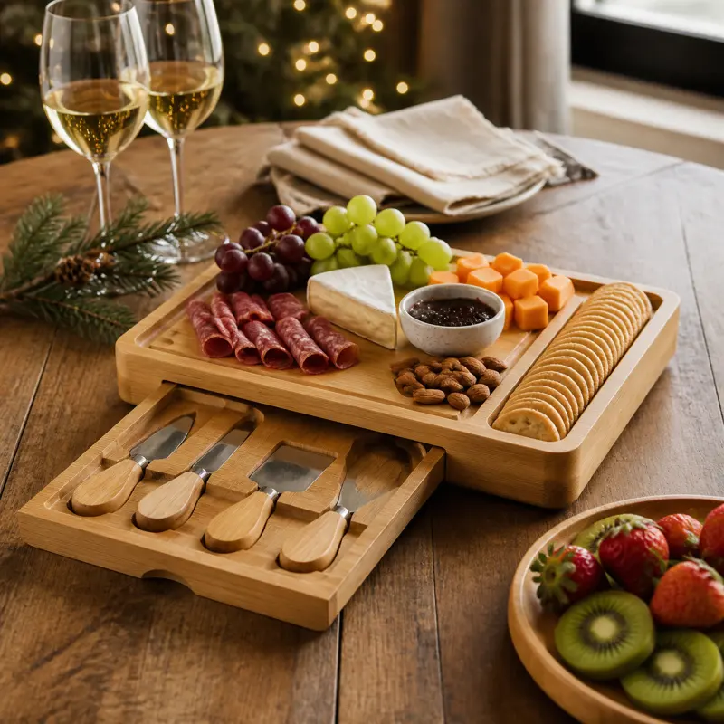
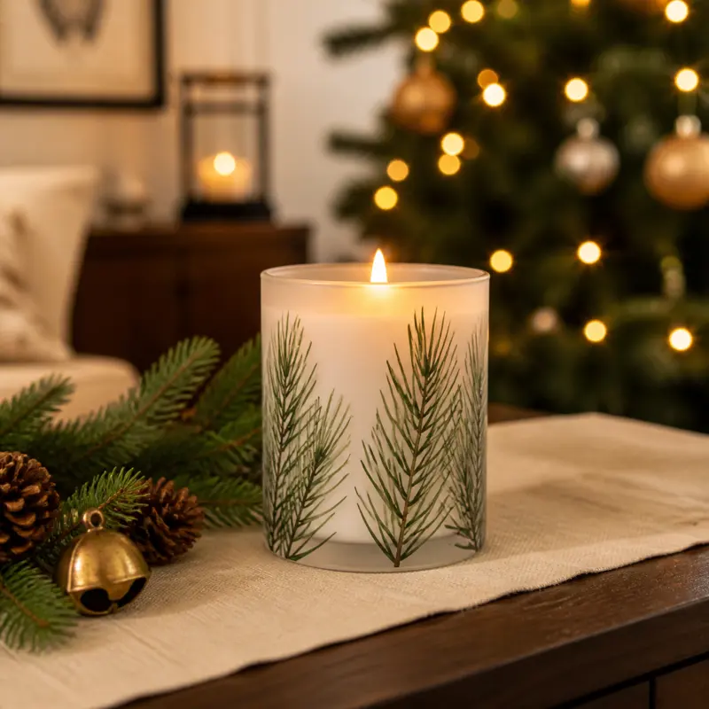
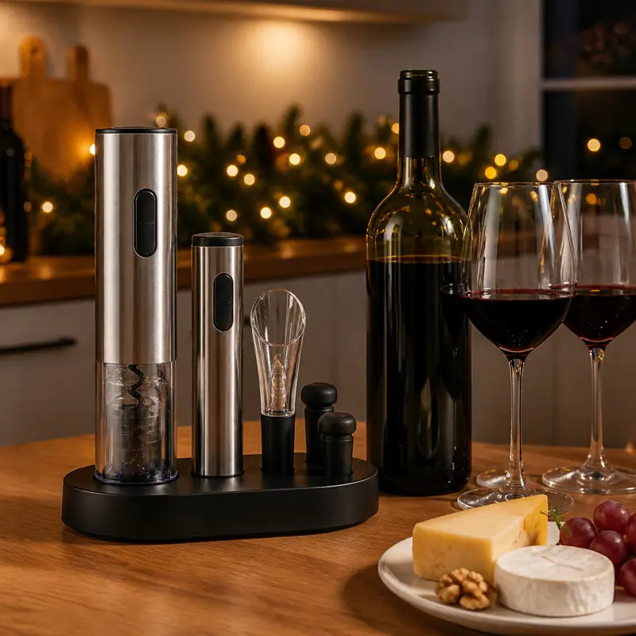

A good Christmas hostess gift says thank you without giving the host one more thing to manage on a busy night. The best ones are useful after the party: something for the next gathering, something that makes the house smell like the holidays, or something that makes opening a bottle easier.

We chose three Christmas hostess gifts that do exactly that. Each one is a top seller with thousands of Amazon ratings, each one arrives ready to give, and each one fits almost any host, from your sister-in-law to the neighbor throwing the street party. We checked every rating and rating count on Amazon on the date above. Prices change often during the holidays, so check the current price on Amazon before you order.

## Best overall: SMIRLY Bamboo Charcuterie Board Set with Serving Accessories

### Why we like it

If your host likes to entertain, this is the gift they will reach for again and again. The 13 x 13 inch bamboo board has a hidden slide-out drawer that stores the included tools, so everything stays together in the cupboard. Inside the set you get the board with its drawer, a fruit tray, two round bowls, four cheese knives with wooden handles, two slate labels and two chalk markers. Grooves along the board hold crackers in neat rows, and SMIRLY includes a free platter guide for anyone who wants help building a spread.

It also ships in a gift box, which saves you a wrapping step, and it is the number one seller in Amazon's Cheese Servers category. With a 4.8-star rating across more than 21,000 ratings, it is the most-reviewed pick on this list by a wide margin.

### Who it's for

Hosts who love a grazing board, new homeowners, couples who entertain often, and anyone who hosts game nights or wine nights after the holidays.

### Pros

- Complete set: board, fruit tray, bowls, four knives, labels and markers
- Hidden drawer keeps the knives and accessories with the board
- Arrives in a gift box
- Exceptional rating across more than 21,000 ratings
- Useful at every party long after Christmas

### Cons

- Bamboo needs hand washing and should not go in the dishwasher
- The 13-inch board is a medium size; very large spreads may need a second board
- Takes up more cupboard space than a candle or a wine tool

{{ product B07DL7ZV31 }}

## Best cozy gift: Thymes Frasier Fir Pine Needle Candle

### Why we like it

A candle is the classic hostess gift for a reason, and Thymes Frasier Fir is one of the best-known holiday scents around. Thymes describes it as Siberian fir needles with cedarwood and sandalwood, so it smells like a fresh-cut tree rather than a sugary bakery candle. That makes it easy to give to almost anyone, including hosts who are picky about fragrance.

The 6.5 oz candle comes in a glass jar printed with a pine needle design, so it looks festive on a mantel or coffee table even before it is lit. Thymes lists a burn time of about 45 hours and says the candle is made in the USA with globally sourced components, is cruelty-free, and comes in a recyclable jar. For the cleanest burn, Thymes recommends trimming the wick to about a quarter inch before each use.

### Who it's for

Any host, plus neighbors, coworkers and teachers. It is the easiest gift on this list to grab in multiples if you have several parties on your calendar.

### Pros

- Fresh fir, cedar and sandalwood scent that suits the season
- Pretty pine needle jar works as decor
- About 45 hours of burn time, according to Thymes
- Strong 4.6-star rating across more than 6,000 ratings
- Easy to buy for several hosts at once

### Cons

- This listing is the jar only, with no gift box, so plan to add a bag or ribbon
- Scent is personal; some people prefer unscented candles
- Made with paraffin wax, which matters to buyers who only want soy or coconut wax

{{ product B00YPP2LBM }}

## Best for wine lovers: Ivation Electric Wine Opener, Aerator and Preserver Gift Set

### Why we like it

If you were going to bring a bottle of wine anyway, this set is a smart upgrade. The stainless steel electric opener pulls a cork at the press of a button, and Ivation says it removes up to 30 corks on a full charge. A see-through window lets you watch the cork come out, and the opener sits on a charging base with a blue LED light, so it is always ready on the counter.

The seven-piece set also includes an aerator and pourer, a foil cutter, and an electric vacuum pump with date-stamped stoppers. The pump removes air from an open bottle, and the date markers help the host remember when each bottle was opened. It is a full wine kit in one box, which makes it feel like a bigger gift than a single tool.

### Who it's for

Wine lovers, hosts who throw dinner parties, and anyone with hand or wrist trouble who finds a manual corkscrew frustrating.

### Pros

- One-button cork removal, up to 30 corks per charge
- Includes an aerator, foil cutter and vacuum preserver with dated stoppers
- Rechargeable on its own base, with no batteries to buy
- 4.6-star rating across more than 4,000 ratings
- Pairs well with a bottle of wine for a two-part gift

### Cons

- Only useful for hosts who drink wine
- The charging base needs counter space near an outlet
- Not for screw-cap bottles, which do not need an opener

{{ product B0782QFDDJ }}

## How to choose a Christmas hostess gift

Start with how the host lives. Someone who hosts often will get the most from a serving set they can use at every party. A host with a small kitchen or a minimalist style will appreciate something consumable, like a candle, that does not need storage space. A wine lover will enjoy a tool that upgrades a habit they already have.

Then think about timing. Hostess gifts are usually handed over at the door, so pick something that does not need to be opened, served or refrigerated during the party. All three picks here can be set aside and enjoyed later.

## Gift pairing ideas

- **The party starter:** the SMIRLY board with a wedge of good cheese and a box of crackers tucked inside the gift box.
- **The cozy thank-you:** the Thymes Frasier Fir candle with a handwritten card and a bundle of fresh pine from your yard.
- **The wine night:** the Ivation set with a bottle of the host's favorite red, so they can try it right away.

## Buying tips

- **Order early:** popular holiday gifts can sell out or ship slowly in December.
- **Wrap the candle:** this Thymes listing is the jar only, so add a gift bag or a ribbon and tag.
- **Add a note:** a short thank-you card makes even a simple gift feel personal.
- **Check the current price on Amazon:** holiday prices change daily, so compare before you buy.

Looking for more ideas? See our [cozy Christmas gifts under $30](/home/cozy-christmas-gifts-under-30/), our [gifts for new homeowners](/home/gifts-for-new-homeowners/), our [Christmas table setting ideas](/home/christmas-table-setting-ideas/) and our [kitchen gadget gifts for home cooks](/kitchen/best-kitchen-gadget-gifts-for-home-cooks/), or browse the full [holiday gift guide](/holiday-gift-guide/).

## The bottom line

If you want one Christmas hostess gift that feels generous and gets used all year, choose the **SMIRLY bamboo charcuterie board set**. It is complete, it arrives in a gift box and it has one of the strongest rating records we have seen in the category. For an easy, cozy thank-you you can buy in multiples, the **Thymes Frasier Fir candle** smells like the holidays and looks festive on any table. And for the host who loves wine, the **Ivation electric wine opener gift set** turns a simple bottle into a complete, thoughtful gift.
