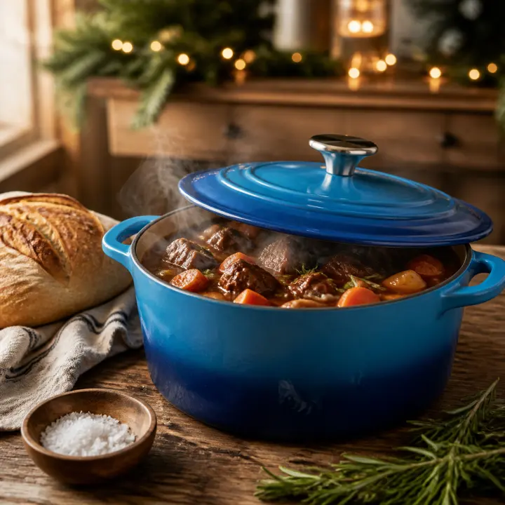
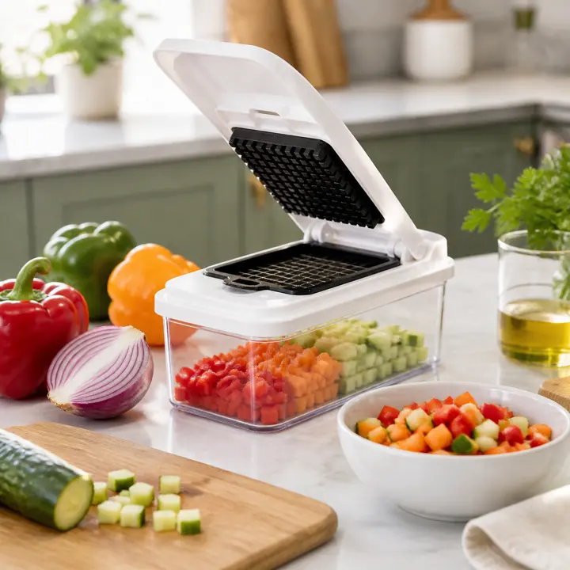
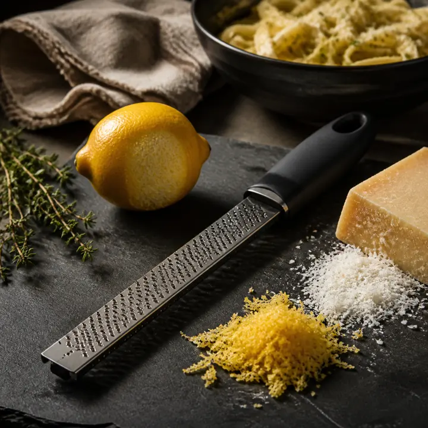

Buying a gift for someone who loves to cook can be surprisingly hard. Serious home cooks often already have the basics, and the gadget aisle is full of single-use novelties that end up in the back of a drawer by February. The best kitchen gifts are the opposite: tools that make everyday cooking easier, look good on the counter or stove, and get used every single week.

We picked three highly rated kitchen gifts at three different sizes, so you can match the gift to your budget and the person: a big centerpiece gift, a practical gadget, and a small stocking stuffer. We checked each product's star rating, rating count and stock status on its Amazon page on the date above. Prices change often during the holidays, so check the current price on Amazon before you buy.

Building a kitchen from scratch instead? Start with our list of [kitchen essentials every home cook needs](/kitchen/kitchen-essentials-every-home-cook-needs/), or see our guide to the [best chef knife for home cooks](/kitchen/best-chef-knife-for-home-cooks/) if a knife is on your list.

## Best big gift: Lodge Essential Enamel Cast Iron Dutch Oven, 6 Quart

<figure></figure>

### Why we like it

If you want one gift that feels special and still gets used constantly, an enameled Dutch oven is hard to beat. Lodge's Essential Enamel Dutch Oven gives you the main benefits of cast iron, great heat retention and durability, without the worry about rust, and Lodge notes that it is PFAS free. Because the inside is enameled, there is no seasoning routine to learn, which makes it a friendly gift even for newer cooks.

It is stovetop compatible and oven safe up to 500°F, so it handles the full arc of a recipe: brown meat on the stove, add liquid, then move the whole pot into the oven to braise. Lodge positions it for bread baking, braising, marinating and slow cooking, with a moisture-sealing lid. The listing also says it comes with six pot protectors to help prevent chipping when you stack or store it. It holds a 4.7-star average from more than 39,000 ratings, which is a remarkable number for cookware.

The 6-quart size is a practical middle ground: big enough for a family pot of chili, a whole chicken or a loaf of no-knead bread, but not so big that it is awkward for weeknight cooking. It also comes in a variety of colors, so you can match the cook's kitchen. We featured the Caribbean Blue version.

### Who it's for

Cooks who love soups, stews, chili, braises and homemade bread, newlyweds and new homeowners, and anyone who has been eyeing an enameled Dutch oven but hasn't bought one for themselves yet. It is also a great shared "family gift" for the person who hosts holiday dinners.

### Pros

- Excellent rating from a very large number of buyers
- Enameled cast iron: no seasoning and no rust worries
- Oven safe up to 500°F and works on the stovetop
- Comes with pot protectors and a lifetime limited warranty
- Available in several colors

### Cons

- Cast iron is heavy, especially when full; not ideal for anyone with wrist or grip issues
- Lodge recommends hand washing to keep the enamel looking its best, even though it is dishwasher safe
- Enamel can chip if it is banged against hard surfaces

{{ product B000N4WN08 }}

## Best everyday gadget: Fullstar Pro Original Vegetable Chopper & Spiralizer

<figure></figure>

### Why we like it

Chopping onions, peppers and carrots is the most repetitive part of home cooking, and this is the gadget that makes it faster. The Fullstar Pro Original is a press-down chopper: you place a vegetable on the blade grid, close the lid, and the pieces drop straight into a 5-cup container below. Fullstar says it dices in about 30 seconds, and the container catches every piece and doubles as a storage bowl, so counters stay clean.

It has heavy-duty, rust-resistant 420 stainless steel blades, a soft-grip handle and a non-skid rubber base to keep it steady as you press. It also spiralizes zucchini. All of the blades store inside the container, so it stays together in one compact unit in a drawer or cabinet. Cleanup is simple: the included cleaning brush and scraper push food out of the dicing grid, and the parts go on the top rack of the dishwasher. It is BPA-free and backed by Fullstar's limited lifetime warranty.

With a 4.5-star average from more than 122,000 ratings, it is one of the most-reviewed kitchen gadgets on Amazon.

### Who it's for

Busy parents, meal preppers, anyone who finds dicing tedious, and cooks with tired hands who want to do less knife work. It is a smart gift for a host who cooks big holiday meals, where a mountain of diced onions, celery and carrots is part of the job.

### Pros

- Huge number of ratings with a strong average
- Dices into a 5-cup container, so prep and storage happen in one step
- Top-rack dishwasher safe, with a cleaning brush and scraper included
- Blades store inside the unit
- Non-skid base and soft-grip handle

### Cons

- This is the classic dicing model; Fullstar sells other versions if you want mandoline slicing blades
- It takes up more drawer space than a knife
- Large or very hard vegetables usually need to be cut into smaller pieces first

{{ product B0764HS4SL }}

## Best stocking stuffer: Microplane Classic Zester Grater

<figure></figure>

### Why we like it

Ask a group of serious home cooks which small tool they use most and a rasp zester will come up again and again. The Microplane Classic is the original long, narrow zester grater, and it holds a 4.8-star average from more than 11,000 ratings.

Microplane makes its blades with a photo-etching process in the USA, which gives them very sharp teeth. The listing says the blade is designed to take the flavorful rind off citrus while leaving the bitter white pith behind, perfect for vinaigrettes, stir fries, salads and baked goods. It also turns parmesan into fluffy mounds that melt quickly over pasta, eggs and salads. The blade is surgical grade stainless steel that stays rust-free, and because it is magnetic, it can hang on a magnetic knife strip. The handle is BPA free plastic, and the tool is dishwasher safe.

### Who it's for

Bakers, pasta lovers, anyone who cooks with lemons and limes, and the cook who "has everything." It is the perfect add-on to a bigger gift, a teacher or coworker gift, or a stocking stuffer. For more small-gift ideas, see our [stocking stuffers under $20](/home/stocking-stuffers-under-20/).

### Pros

- Outstanding 4.8-star rating
- Very sharp, photo-etched blade made in the USA
- Zests citrus without the bitter pith and grates hard cheese finely
- Dishwasher safe and rust-free
- Slim enough to fit in any drawer or stocking

### Cons

- Very sharp; store it carefully and keep fingers clear of the teeth
- Made for fine grating, not for coarse shredding or slicing
- Only a 1-year warranty, shorter than the other two picks

{{ product B00004S7V8 }}

## How to choose a kitchen gift for a home cook

- **Think about what they cook most:** a soup-and-bread person will love the Dutch oven, a weeknight meal prepper will use the chopper daily, and a baker or pasta lover will reach for the zester constantly.
- **Choose daily use over novelty:** single-purpose gadgets that do one unusual job often get forgotten. All three picks here handle jobs that come up week after week.
- **Check what they already own:** if they have a bare-cast-iron Dutch oven, an enameled one is still a different, easier-care tool; if they already have a zester, skip it.
- **Consider weight and storage:** cast iron is heavy, and a chopper needs drawer or cabinet space. A zester is the safe choice for a small kitchen.
- **Look at care instructions:** the chopper and zester are dishwasher safe, while the Dutch oven is dishwasher safe but Lodge recommends hand washing.
- **Pair small gifts with big ones:** a zester tucked into a ribboned Dutch oven makes a thoughtful bundle.

## Gift-wrapping and pairing ideas

Fill the Dutch oven with a bag of good flour, a jar of yeast and a handwritten bread recipe, then tie the lid with a wide ribbon. Pair the chopper with a favorite salsa or soup recipe card. Tuck the Microplane into a stocking with a few lemons and a wedge of parmesan. If you are still shopping for the host of a big holiday meal, our [Thanksgiving cooking tools guide](/kitchen/thanksgiving-cooking-tools-for-turkey-day/) has more ideas, and our [gift finder](/gift-finder/) can help you browse by person and budget.

## The bottom line

For a big, memorable gift, the **Lodge Essential Enamel Cast Iron Dutch Oven** is our top pick: it is versatile, easy to care for and loved by tens of thousands of buyers. The **Fullstar Pro Original Vegetable Chopper** is the most practical everyday gadget for anyone who wants faster prep, and the **Microplane Classic Zester** is the small stocking stuffer that most home cooks end up using every week.

Related reading: [cozy gifts for her](/gifts/cozy-gifts-for-her/) and [gifts for new homeowners](/home/gifts-for-new-homeowners/).
